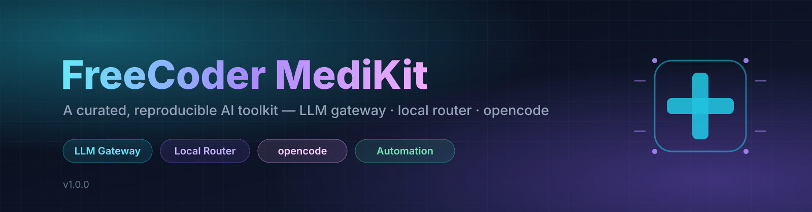
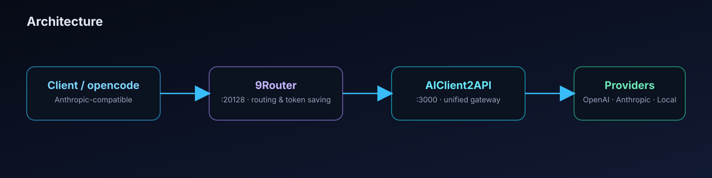

<div align="center">



<br/>

[](https://github.com/sakthikolanji06-boop/FreeCoderMediKit/releases)
[](https://github.com/sakthikolanji06-boop/FreeCoderMediKit/releases)
[](#attribution)

</div>

## Overview

**FreeCoder MediKit** is a curated, reproducible bundle of the AI tooling used for
LLM app development, agents, routing, and automation — packaged so anyone can run the
same stack in minutes.

- **One bundle** — gateway, router, client setup, and docs in one place
- **Reproducible** — pinned sources, no machine-specific state
- **Secret-free** — no keys, tokens, databases, or logs

## Architecture

<div align="center">

</div>

## What's inside

| Component | Purpose | Upstream | License |
|---|---|---|---|
| **AIClient2API** | OpenAI/Anthropic-compatible gateway that unifies model providers behind one API | [justlovemaki/AIClient-2-API](https://github.com/justlovemaki/AIClient-2-API) | GPL-3.0 |
| **9Router** | Local AI router / token saver with dashboard and provider pools | [decolua/9router](https://github.com/decolua/9router) | MIT |
| **scripts/** | `start-claude-local`, `claude-launch` | — | — |
| **docs/SETUP.md** | Step-by-step local stack setup | — | — |
| **docs/OPENCODE.md** | Install & configure opencode | — | — |

## Quick start

```bash
# 1) API gateway
cd AIClient2API
npm install
cp configs/provider_pools.json.example configs/provider_pools.json   # add your own keys
./install-and-run.sh

# 2) Router
cd ../9router
npm install
cp .env.example .env                                                 # add your own keys
npm run dev

# 3) Point your client at the router
export ANTHROPIC_BASE_URL=http://127.0.0.1:20128/v1
export ANTHROPIC_MODEL=claude-sonnet-5
```

## Documentation

| Guide | Description |
|---|---|
| [docs/SETUP.md](docs/SETUP.md) | Run the local AI stack end to end |
| [docs/OPENCODE.md](docs/OPENCODE.md) | Install & configure the opencode coding agent |

## Security

This kit contains **no API keys, tokens, databases, or logs**. All sensitive files
(`.env`, `configs/*.json`, `*.db`, `logs/`) are intentionally excluded — configure
your own credentials from the provided `*.example` templates.

## Attribution

Third-party components remain under their original licenses. See
[ATTRIBUTION.md](ATTRIBUTION.md) and the `LICENSE` file inside each component directory.
