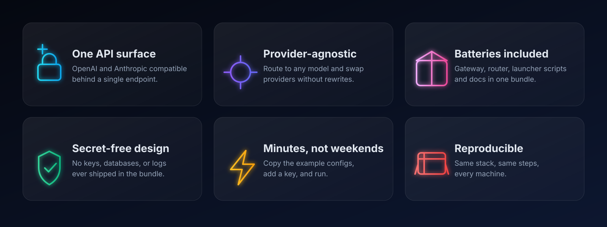

<div align="center">


### Run a full LLM stack in minutes — no API juggling, no vendor lock-in.

[](https://github.com/sakthikolanji06-boop/FreeCoderMediKit/stargazers)
[](https://github.com/sakthikolanji06-boop/FreeCoderMediKit/releases)
[](https://github.com/sakthikolanji06-boop/FreeCoderMediKit/releases)
[](CONTRIBUTING.md)

**One bundle. Three layers. Any model.**
Gateway + router + coding agent — wired together, secret-free, reproducible.

</div>

---

## Why FreeCoder MediKit?

Most AI setups break the moment you change providers. Keys live in five places,
every tool speaks a different API, and nothing is reproducible.

**FreeCoder MediKit fixes that:**

- 🔌 **One API surface** — OpenAI *and* Anthropic compatible
- 🧭 **Provider-agnostic** — route to any model, swap without rewriting code
- 🧰 **Batteries included** — gateway, router, launcher scripts, and docs
- 🔒 **Secret-free by design** — no keys, DBs, or logs in the bundle
- ⚡ **Minutes, not weekends** — copy the `*.example` configs, add your key, run

## Features

<div align="center">

</div>

## One command to start

```bash
git clone https://github.com/sakthikolanji06-boop/FreeCoderMediKit.git
cd FreeCoderMediKit && ./scripts/start-claude-local services
```

Then point any client at `http://127.0.0.1:20128/v1`.

## Architecture

<div align="center">

</div>

## What's inside

| Component | Purpose | Upstream | License |
|---|---|---|---|
| **AIClient2API** | OpenAI/Anthropic-compatible gateway that unifies model providers behind one API | [justlovemaki/AIClient-2-API](https://github.com/justlovemaki/AIClient-2-API) | GPL-3.0 |
| **9Router** | Local AI router / token saver with dashboard and provider pools | [decolua/9router](https://github.com/decolua/9router) | MIT |
| **scripts/** | `start-claude-local`, `claude-launch` | — | — |
| **docs/SETUP.md** | Step-by-step local stack setup | — | — |
| **docs/OPENCODE.md** | Install & configure opencode | — | — |

## Quick start (manual)

```bash
# 1) API gateway
cd AIClient2API
npm install
cp configs/provider_pools.json.example configs/provider_pools.json   # add your own keys
./install-and-run.sh

# 2) Router
cd ../9router
npm install
cp .env.example .env                                                 # add your own keys
npm run dev

# 3) Point your client at the router
export ANTHROPIC_BASE_URL=http://127.0.0.1:20128/v1
export ANTHROPIC_MODEL=claude-sonnet-5
```

## Documentation

| Guide | Description |
|---|---|
| [docs/SETUP.md](docs/SETUP.md) | Run the local AI stack end to end |
| [docs/OPENCODE.md](docs/OPENCODE.md) | Install & configure the opencode coding agent |
| [ROADMAP.md](ROADMAP.md) | What's next |
| [CONTRIBUTING.md](CONTRIBUTING.md) | How to help |

## Security

This kit contains **no API keys, tokens, databases, or logs**. All sensitive files
(`.env`, `configs/*.json`, `*.db`, `logs/`) are intentionally excluded — configure
your own credentials from the provided `*.example` templates.

## Star history

<div align="center">
<a href="https://star-history.com/#sakthikolanji06-boop/FreeCoderMediKit&Date">
  
</a>
</div>

---

<div align="center">

**If this saved you a weekend, drop a ⭐ — it helps others find it.**

<a href="https://github.com/sakthikolanji06-boop/FreeCoderMediKit/stargazers">
  
</a>

</div>

## Attribution

Third-party components remain under their original licenses. See
[ATTRIBUTION.md](ATTRIBUTION.md) and the `LICENSE` file inside each component directory.
